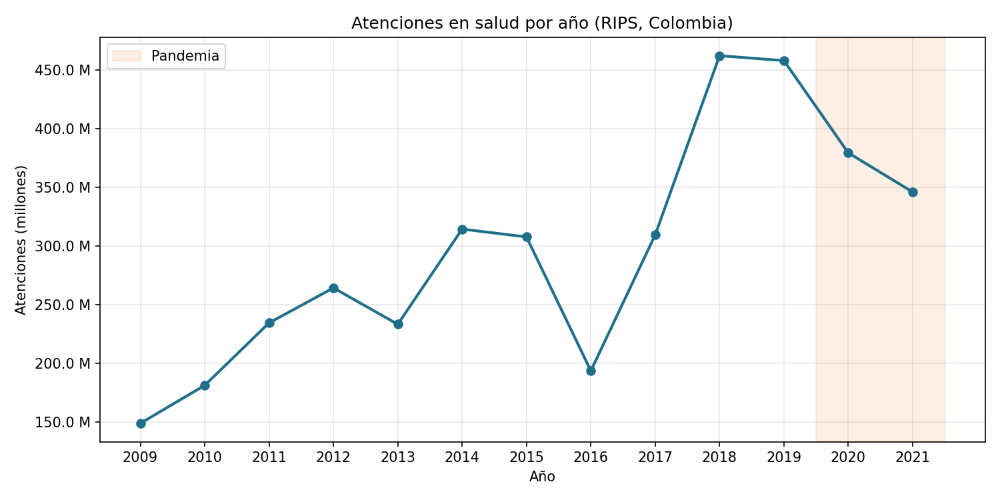
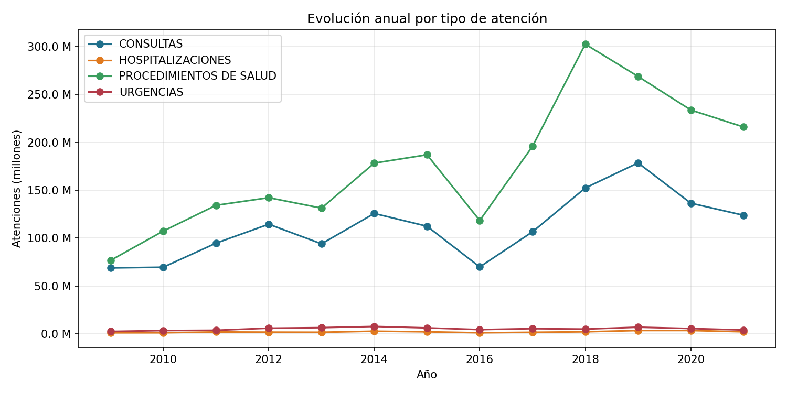
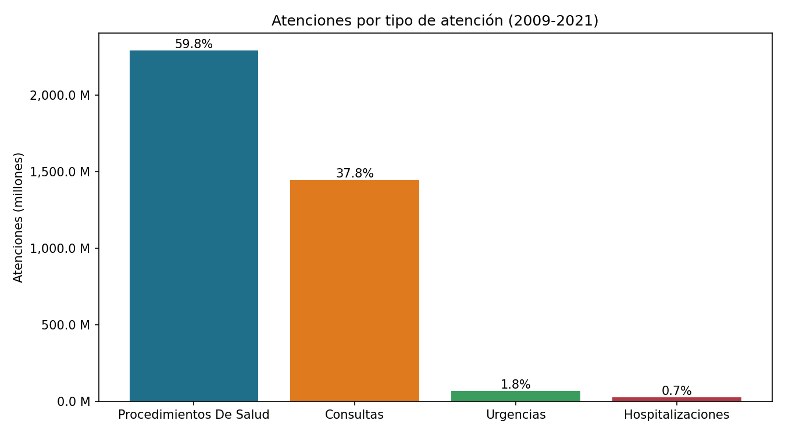
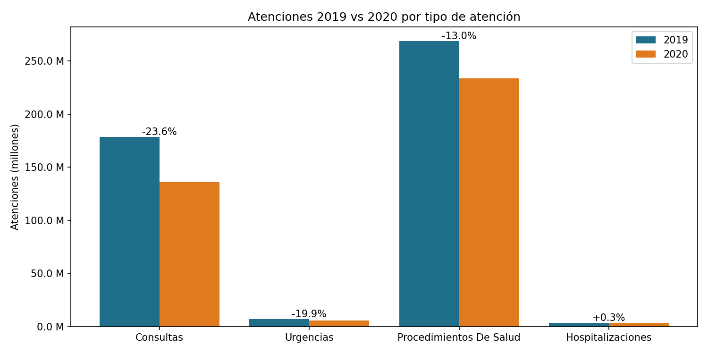
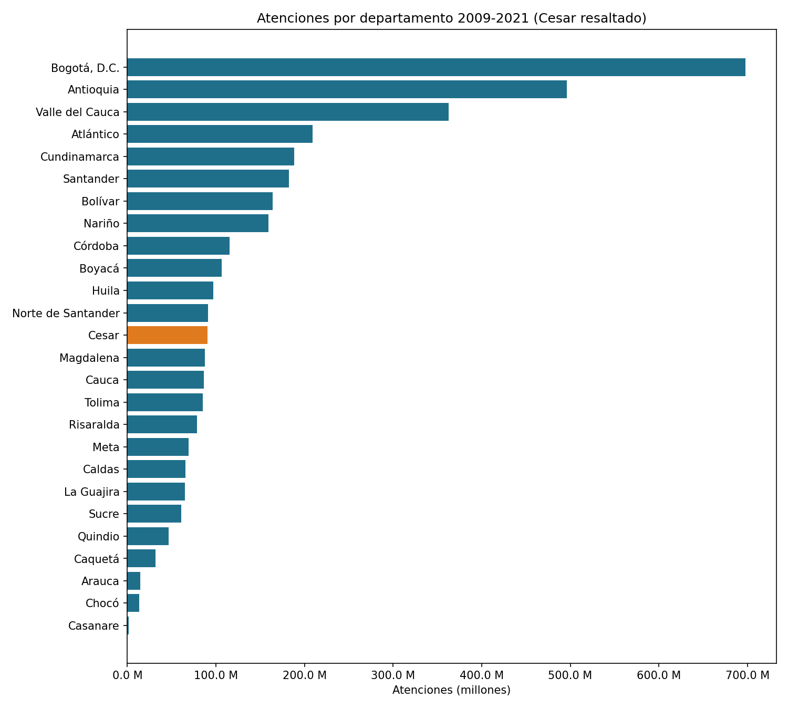
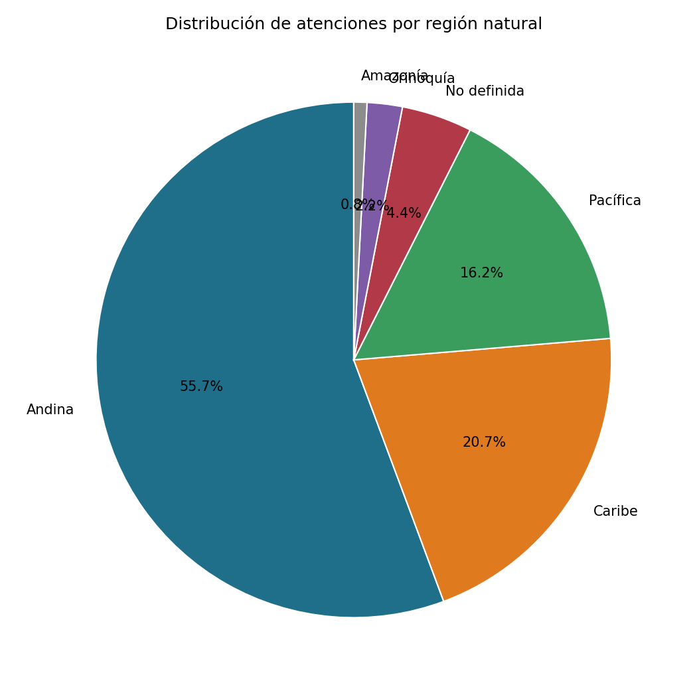
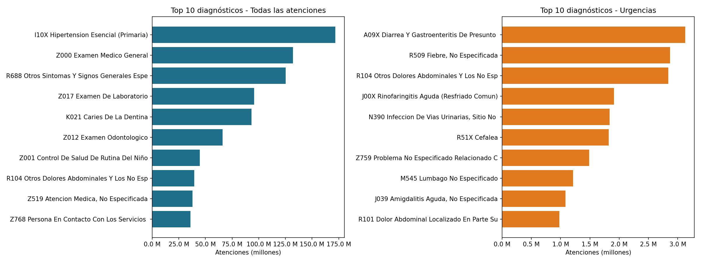
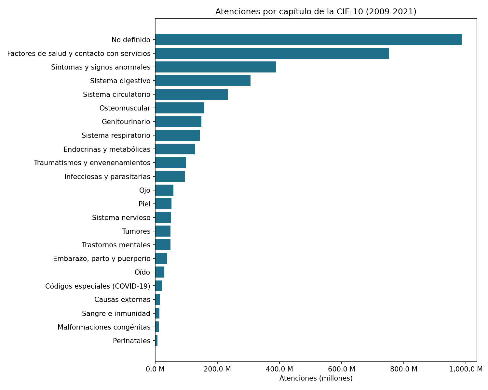
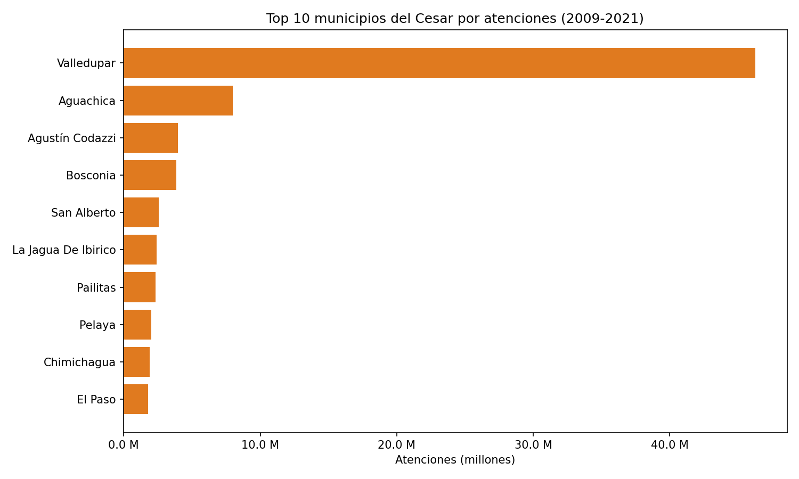

# Análisis de la demanda de servicios de salud en Colombia con Apache Spark (RIPS 2009-2021)

**Curso:** Big Data (202016911), Universidad Nacional Abierta y a Distancia (UNAD)
**Actividad:** Tarea 3. Procesamiento de Datos con Apache Spark
**Autor:** Daniel Andrés Mercado Trillos

## Problema

> ¿Cómo ha evolucionado la demanda de servicios de salud en Colombia entre 2009 y 2021 según el tipo de atención, el departamento y el diagnóstico, y qué impacto tuvo la pandemia de 2020 en esa demanda?

Preguntas específicas:

1. ¿Cuántas atenciones se registraron por año y cómo se comporta la tendencia?
2. ¿Qué tipo de atención concentra la mayor demanda?
3. ¿Qué departamentos registran más atenciones? (con énfasis en el Cesar)
4. ¿Cuáles son los 10 diagnósticos más frecuentes, en general y en urgencias?
5. ¿Cómo cambió el volumen de atenciones en 2020 frente a 2019?

## Conjunto de datos

| Característica | Valor |
|---|---|
| Nombre | Registros Individuales de Prestación de Servicios de Salud (RIPS) |
| Fuente | Portal de Datos Abiertos de Colombia, [datos.gov.co](https://www.datos.gov.co) |
| Tamaño | 4,5 GB (CSV), 38.000.000 de registros, 3.833 millones de atenciones |
| Periodo | 2009 - 2021 |
| Columnas | Departamento, Municipio, Año, TipoAtencion, Diagnostico, NumeroAtenciones |

El dataset no se incluye en el repositorio por su tamaño. Se descarga desde datos.gov.co en formato CSV.

**Problemas de calidad detectados**

- Doble codificación de caracteres en 1,7 millones de registros ("Bogotá" en lugar de "Bogotá").
- 245.087 registros con departamento "NO DEFINIDO" y un 25,7 % de las atenciones con diagnóstico "NO DEFINIDO".
- La descarga se detiene en 38.000.000 de filas, así que no incluye Putumayo, San Andrés, Amazonas, Guainía, Guaviare, Vaupés ni Vichada, y Casanare queda incompleto.

## Arquitectura de la solución

```
CSV (4,5 GB) ──► HDFS ──► 01_limpieza_rips.py ──► Parquet en HDFS ──► 02_analisis_rips.py ──► gráficas PNG + tablas CSV
                         (carga, limpieza,        (particionado          (EDA con DataFrames,
                          transformación)          por año)               Spark SQL y RDD)
```

### `01_limpieza_rips.py`: carga, limpieza y transformación

- **Carga** desde HDFS con un esquema explícito, para no recorrer los 4 GB solo para inferir tipos.
- **Perfil de calidad** con todas las métricas calculadas en una sola pasada (nulos, valores inválidos, textos mal codificados).
- **Corrección de codificación eficiente:** se extraen los ~13.700 textos distintos, se corrigen en el driver y se aplican con un *broadcast join*, en lugar de procesar con una UDF los 38 millones de filas.
- **Limpieza:** normalización de espacios, eliminación de nulos y valores fuera de rango, y consolidación de duplicados sumando atenciones (no se pierde información).
- **Transformación:** separación de código y nombre, región natural (mapa por código DANE), capítulo de la CIE-10 y periodo prepandemia/pandemia.
- **Salida** en formato **Parquet** (columnar y comprimido), particionado por año.

### `02_analisis_rips.py`: análisis exploratorio y visualización

- Un **cubo agregado en caché** reduce los 38 M de filas a unas decenas de miles, y se reutiliza en varios análisis.
- **DataFrames:** `groupBy`, `agg`, `pivot` y funciones de ventana (`lag` para la variación anual, `row_number` para el ranking).
- **Spark SQL:** top 10 de diagnósticos, en general y en urgencias.
- **RDD:** top de municipios del Cesar con `map`, `filter`, `reduceByKey`, `takeOrdered`, `reduce` y `count`.
- **Visualización:** 9 gráficas con Matplotlib a partir de los resultados agregados. Solo los resultados pequeños se pasan a pandas.

## Requisitos

- Apache Spark 3.5.x y Apache Hadoop (HDFS) 3.x
- Python 3.10 o superior
- Librerías: ver `requirements.txt`

Probado en una máquina virtual Ubuntu con 3,8 GB de RAM, Spark 3.5.8 en modo local y HDFS en `hdfs://localhost:9000`.

## Instrucciones de ejecución

1. **Iniciar HDFS** (con el usuario de Hadoop):
   ```bash
   start-dfs.sh
   jps   # deben aparecer NameNode, DataNode y SecondaryNameNode
   ```

2. **Cargar el dataset en HDFS:**
   ```bash
   hdfs dfs -mkdir -p /Tarea3
   hdfs dfs -put rips.csv /Tarea3/
   hdfs dfs -chmod 777 /Tarea3
   ```

3. **Instalar dependencias:**
   ```bash
   pip install -r requirements.txt
   ```

4. **Ejecutar la limpieza** (≈15 minutos con 38 M de registros):
   ```bash
   spark-submit --driver-memory 1500m 01_limpieza_rips.py
   ```

5. **Ejecutar el análisis:**
   ```bash
   spark-submit --driver-memory 1500m 02_analisis_rips.py
   ```
   Las gráficas quedan en `graficas/` y las tablas en `resultados/`.

> **Nota sobre memoria:** en máquinas con menos de 4 GB de RAM se recomienda habilitar memoria de intercambio (`sudo fallocate -l 4G /swapfile && sudo chmod 600 /swapfile && sudo mkswap /swapfile && sudo swapon /swapfile`) y detener YARN (`stop-yarn.sh`), porque Spark corre en modo local.

Ambos scripts aceptan rutas personalizadas como argumentos:
```bash
spark-submit 01_limpieza_rips.py <ruta_csv_entrada> <ruta_parquet_salida>
spark-submit 02_analisis_rips.py <ruta_parquet>
```

## Resultados principales

| Pregunta | Hallazgo |
|---|---|
| Tendencia | Las atenciones crecieron de 149 M (2009) a 462 M (2018), es decir, se triplicaron |
| Tipo de atención | Procedimientos 59,8 %, consultas 37,8 %, urgencias 1,8 %, hospitalizaciones 0,7 % |
| Departamentos | Bogotá (698 M), Antioquia (496 M) y Valle (363 M) lideran; el Cesar ocupa el puesto 13 de 26 (90,2 M) |
| Diagnósticos | Hipertensión esencial (172 M) es el principal; en urgencias lidera la diarrea y gastroenteritis (3,1 M) |
| Pandemia | 2020 cayó 17,1 % frente a 2019: consultas −23,6 %, urgencias −19,9 %, procedimientos −13,0 %; hospitalizaciones estables (+0,3 %) |

### Gráficas

| | |
|---|---|
|  |  |
|  |  |
|  |  |
|  |  |
|  | |

## Estructura del repositorio

```
├── 01_limpieza_rips.py     # Carga, limpieza y transformación → Parquet
├── 02_analisis_rips.py     # EDA (DataFrames, Spark SQL, RDD) y gráficas
├── requirements.txt
├── graficas/               # Gráficas generadas (PNG)
└── resultados/             # Tablas resumen (CSV)
```
